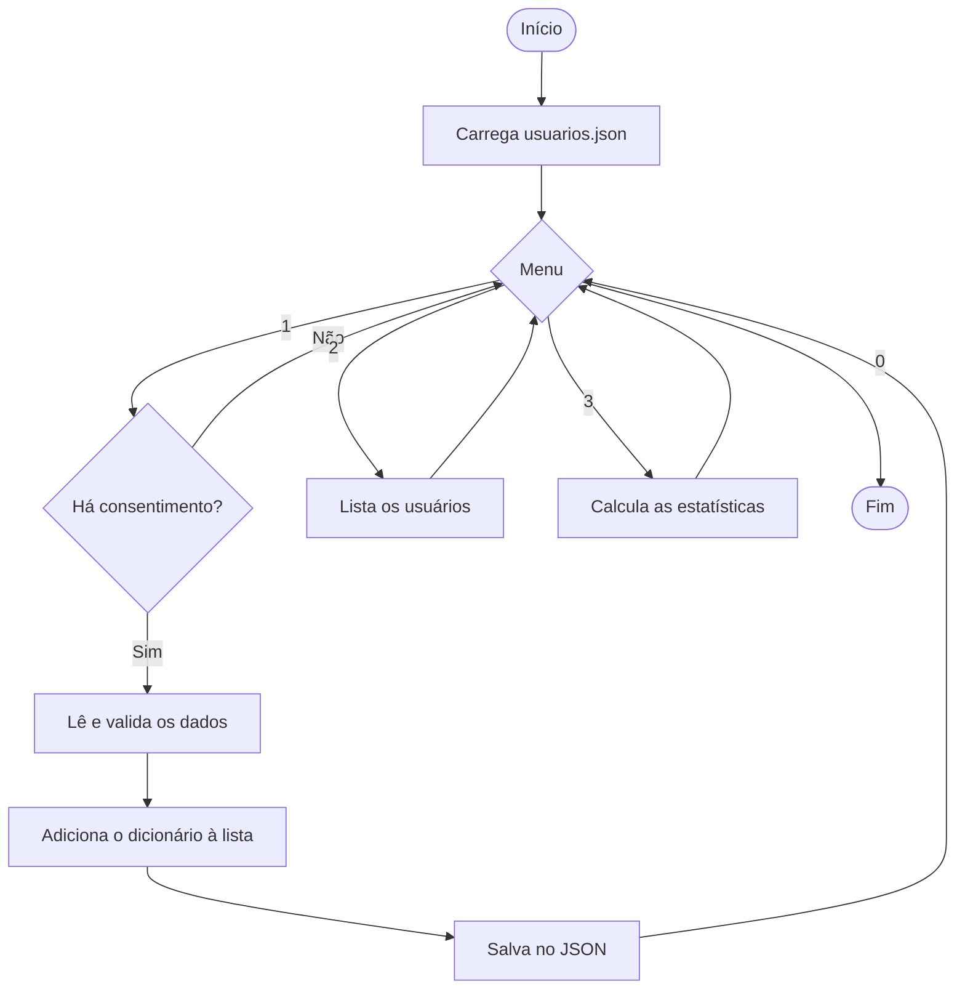

<div align="center">

# 🌐 Tech Inclusão

### Educação digital segura para inclusão digital e proteção de dados

*Programa em modo console, escrito em Python, que registra usuários fictícios em **JSON** e transforma os dados em **estatísticas**.*


**UNIP · Análise e Desenvolvimento de Sistemas · PIM I**

</div>

---

## 📖 Sobre o projeto

A **Tech Inclusão** é uma ONG **fictícia** de educação digital, criada como caso de estudo do Projeto Integrado Multidisciplinar (PIM I). Ela quer ensinar pensamento lógico, programação básica em Python e segurança digital a comunidades carentes e a estudantes de escolas públicas.

Este repositório reúne o **programa-protótipo** do projeto. Ele mostra, de forma simples, como:

- 🧩 representar um usuário com um **dicionário** (`dict`);
- 📚 reunir todos os usuários em uma **lista** (`list`);
- 💾 guardar essa lista em disco no formato **JSON**;
- 📊 calcular **estatística descritiva** a partir dos dados;
- 🔒 coletar dados **somente com consentimento**, seguindo a lógica da LGPD.

> ⚠️ **Aviso:** todos os dados do projeto são **fictícios**. Nenhuma informação de pessoa real foi coletada, e o programa não deve ser usado com dados reais sem as medidas de segurança descritas no relatório do PIM.

---

## ✨ Funcionalidades

| # | Opção do menu | O que faz |
|:-:|---|---|
| 1 | **Cadastrar usuário** | Pede o consentimento e, se houver autorização, registra idade, acessos, tempo de uso e módulos concluídos |
| 2 | **Listar usuários** | Mostra os registros em uma tabela de texto |
| 3 | **Ver estatísticas** | Calcula média, mediana, moda, desvio padrão, mínimo e máximo, além da distribuição por faixa etária |
| 0 | **Sair** | Encerra o programa |

---

## 🚀 Como executar

**Requisito:** Python 3.8 ou superior. Não é preciso instalar nenhuma biblioteca, pois o programa usa apenas a biblioteca padrão.

```bash
# 1. Baixe o repositório
git clone https://github.com/SEU-USUARIO/NOME-DO-REPOSITORIO.git
cd NOME-DO-REPOSITORIO

# 2. Execute o programa
python tech_inclusao.py
```

> No Linux ou no macOS, talvez seja necessário usar `python3` no lugar de `python`.

### 🧪 Quer testar com dados prontos?

O arquivo `usuarios_exemplo.json` traz **20 usuários fictícios**. O programa lê e grava o arquivo `usuarios.json`, então basta copiar o exemplo com esse nome:

```bash
# Linux / macOS
cp usuarios_exemplo.json usuarios.json

# Windows (Prompt de Comando)
copy usuarios_exemplo.json usuarios.json
```

Depois, execute o programa e escolha a opção **3** para ver as estatísticas.

---

## 🖥️ Exemplo de uso

```text
=== TECH INCLUSÃO ===
1 - Cadastrar usuário
2 - Listar usuários
3 - Ver estatísticas
0 - Sair
Opção: 3

Idade (anos)
  média=30.10  mediana=27.00  moda=27  desvio padrão=12.19  mín=15  máx=61

Acessos no mês
  média=15.40  mediana=16.50  moda=18, 15, 17, 19  desvio padrão=5.21  mín=5  máx=24

Tempo médio (min)
  média=31.15  mediana=31.50  moda=30, 35  desvio padrão=5.89  mín=20  máx=41

Participantes por faixa etária:
  < 18     2  (10.0%)
  18-25    6  (30.0%)
  26-35    7  (35.0%)
  36-45    3  (15.0%)
  46+      2  (10.0%)
```

---

## 🧠 Como funciona

### Fluxo do programa



### Lista de dicionários, salva em JSON

Cada usuário é um **dicionário** do Python, e o conjunto de usuários é uma **lista**. Ao gravar, o módulo `json` converte dicionários em objetos JSON e listas em vetores JSON.

| Python | JSON | Uso no programa |
|---|---|---|
| `dict` | objeto `{ }` | Um usuário |
| `list` | vetor `[ ]` | Todos os usuários |
| `str` | string | Identificador (`id`) |
| `int` | número | Idade, acessos, tempo, módulos |
| `True` / `False` | `true` / `false` | Consentimento |

Veja como fica o arquivo `usuarios.json`:

```json
[
  {
    "id": "U001",
    "idade": 15,
    "acessos_mes": 14,
    "tempo_medio_min": 22,
    "modulos_concluidos": 2,
    "consentimento": true
  }
]
```

### Principais funções

| Função | Responsabilidade |
|---|---|
| `carregar()` | Lê o JSON e devolve a lista de dicionários |
| `salvar()` | Grava a lista de dicionários no JSON |
| `ler_inteiro()` | Pede um número e repete a pergunta até receber um valor válido |
| `cadastrar()` | Registra um usuário, somente com consentimento |
| `listar()` | Exibe os usuários em tabela |
| `medidas()` | Calcula média, mediana, moda, desvio padrão, mínimo e máximo |
| `frequencia_por_faixa()` | Conta os participantes de cada faixa etária |
| `estatisticas()` | Monta o relatório estatístico |
| `menu()` | Controla o laço principal do programa |

---

## 🔐 Privacidade e LGPD

O programa foi pensado com base em princípios da Lei Geral de Proteção de Dados (Lei nº 13.709/2018):

- ✅ **Consentimento:** sem autorização, o cadastro é cancelado.
- ✅ **Necessidade:** só são coletados idade, acessos, tempo de uso e módulos concluídos.
- ✅ **Sem identificação direta:** o participante é identificado por um código (`U001`, `U002`...), nunca pelo nome.
- ✅ **Armazenamento local:** os dados ficam em um arquivo no próprio computador, sem uso de nuvem.

---

## 📁 Estrutura do repositório

```text
.
├── tech_inclusao.py          # programa principal
├── usuarios_exemplo.json     # 20 usuários fictícios para teste
└── README.md                 # este arquivo
```

---

## 🛣️ Próximos passos

- [ ] Editar e excluir usuários (direito de correção e eliminação da LGPD)
- [ ] Autenticação por perfil (aluno, instrutor e administrador)
- [ ] Criptografia do arquivo de dados
- [ ] Exportação de relatórios
- [ ] Migração para banco de dados, caso o número de usuários cresça

## 👤 Autoria

Projeto desenvolvido por **Michely Archetti**, estudante do **Curso Superior de Tecnologia em Análise e Desenvolvimento de Sistemas** da **UNIP (Universidade Paulista)**, campus de São José dos Campos (SP).

<div align="center">

Feito para um trabalho acadêmico · Os dados são fictícios

</div>
